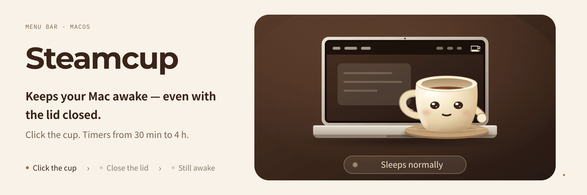

<p align="center"></p>

<h1 align="center">Steamcup</h1>
<p align="center"><strong>菜单栏里一只像素咖啡杯,让 Mac 不睡,合上盖子也不睡。</strong></p>
<p align="center">编译、渲染、跑智能体这类要很久的活,让它接着跑,你合上电脑走开。macOS 14 起可用,Apple 芯片和 Intel 都行。</p>

<p align="center">
  <a href="LICENSE"></a>
  
  
  
</p>

<p align="center">
  <a href="README.md">English</a> ·
  <a href="docs/media/steamcup-explainer.mp4">讲解视频(1 分半,英文)</a> ·
  <a href="docs/media/steamcup-intro.mp4">介绍短片(12 秒)</a> ·
  <a href="#快速开始">快速开始</a> ·
  <a href="#一起做">一起做</a>
</p>

<p align="center"></p>

大多数防睡眠工具只管「闲着别睡」,一合盖 Mac 照样睡。**Steamcup 合上盖子也能接着跑。它停下时会把合盖睡眠改回来;它崩溃或被强制退出,一分钟内也会改回来。**

**点一下就开。合盖模式只输一次密码。Mac 过热或电量低,它自己停。**

**也可以在终端里用:`steamcup run -- <命令>` 让 Mac 一直醒着,合上盖也不睡,直到这条命令跑完。**

## 是什么

一个原生的 macOS 菜单栏小程序,约 700 行 Swift,不依赖任何第三方库。点一下杯子,Mac 就不睡,杯子装满并冒热气;再点一下,恢复正常睡眠。右键是定时和选项。

MacBook 合上盖子就会睡,不管哪个程序怎么要求。唯一的办法是改一个全系统的开关 `pmset disablesleep`,要管理员权限。Steamcup 只在开着的时候改这个开关,下面几种情况都会改回来:
- 你关掉它、定时到点、或者退出
- Mac 过热,或电量降到 10%
- 它崩溃或被强制退出,一分钟内(由一个小的后台检查来改)

> **早期版本。** 在一台装 macOS 26 的 Apple 芯片 MacBook 上手动测过(下载包也能在 Intel Mac 和 macOS 14 以上运行,但还没人试过):开关、定时、合盖模式开和关、正常退出和强制退出(`kill -9` 后一分钟内合盖睡眠就改回来了,两次实测 55 秒和 16 秒)、合着盖时定时到点(Mac 睡下了,唤醒正常)、锁屏暂停、`steamcup run`(命令跑着时开、一结束就关、Ctrl-C)。还没测:macOS 14–15、Intel Mac、过热和低电停止真的触发。见[已知问题](#已知问题)。

## 怎么用

| 你…… | Steamcup 会…… |
| --- | --- |
| 点杯子 | 让 Mac 和屏幕都不睡(电源断言,和 `caffeinate -d` 一样);再点一下停 |
| 右键 → For 30 minutes … 8 hours | 在杯子旁显示剩余时间(`0:30`),到点自己停,中间睡过也照样准 |
| 勾上 **Keep Awake with Lid Closed** | 第一次会要一次管理员密码,并加一个崩溃恢复用的后台检查;勾上就开,杯子上有把小锁,合盖不再让 Mac 睡(屏幕照样黑,Mac 在后面接着跑) |
| Mac 太热时合盖,或用电池到 10% | 15 秒内停掉合盖模式,并弹一条通知 |
| 勾上 **Let the Screen Turn Off** | 屏幕可以熄,Mac 接着跑 |
| 勾上 **Sleep When Screen Locks** | 锁屏时松手,解锁后按原来的结束时间接着来 |
| 任何地方按 **⌃⌥W** | 开或关,刘海挡住杯子时用得上 |
| 在终端跑 `steamcup run -- make build`([先设好命令](#命令行)) | 命令跑完前 Mac 一直醒着,跑完就放手;勾了合盖模式就带合盖模式。Ctrl-C 和命令的退出码原样传回 |
| 在脚本或快捷指令里跑 `open -g 'steamcup://on?minutes=120'` | 开 2 小时(`steamcup://on` 一直开,`steamcup://off` 关);勾了合盖模式就带合盖模式 |

## 可以试试这些

- 点杯子,在终端跑 `pmset -g assertions | grep Steamcup` → 看到 `Steamcup is on`。再点一下 → 没了。
- 右键 → **For 30 minutes** → 杯子旁出现 `0:30`,开始倒数。
- 勾上 **Keep Awake with Lid Closed**(杯子带小锁开起来),跑 `pmset -g | grep SleepDisabled` → 看到 `SleepDisabled 1`。点掉杯子 → 这一行没了。
- 合盖模式开着时放首歌,合盖 30 秒 → 歌一直在放。
- 跑 `steamcup run -- sleep 20`,在另一个窗口跑 `pmset -g assertions | grep Steamcup` → 开着。20 秒后 → 没了。

## 安全吗

- **管理员那一步允许什么:** 只加一个文件 `/etc/sudoers.d/steamcup`,让你的用户不输密码就能跑两条命令:`pmset -a disablesleep 1` 和 `pmset -a disablesleep 0`,别的都不行。装之前先用 `visudo` 检查过规则。可以读 [setup-lid-mode.sh](setup-lid-mode.sh),一共 24 行。
- **密码框里跑的是什么:** 跑的是 app 里自带的那份 `setup-lid-mode.sh`。想确认它和 GitHub 上的一样:`diff /Applications/Steamcup.app/Contents/Resources/setup-lid-mode.sh <(curl -s https://raw.githubusercontent.com/Longado/steamcup/main/setup-lid-mode.sh)`,没有输出就是一样。
- **谁能用这两条命令:** 以你的用户身份运行的任何程序,都能不输密码用这两条命令,不只是 Steamcup。
- **只改自己关的:** Steamcup 会记下自己关过合盖睡眠,只改回它自己关的。你自己跑过 `sudo pmset -a disablesleep 1`,它不会动。
- **发热和电量:** 合着盖子放在包里的 MacBook 会热。合盖模式开着时 Steamcup 每 15 秒查一次,macOS 报告严重过热或电量降到 10% 就停。还没在真机上看到它触发。
- **日志:** Steamcup 开着时,每分钟往 `~/Library/Logs/Steamcup.log` 写一行:盖子开合、电量和电池温度、macOS 报告的发热级别。每次开关和原因、每次改合盖睡眠也记一笔。菜单里的 **Show Log** 能打开它。日志不离开你的 Mac。
- **已经合着盖:** 合着盖时合盖睡眠被改回来(定时到点、过热、低电、崩溃),Steamcup 会用 `pmset sleepnow` 让 Mac 睡下;接着外接显示器用合盖模式时除外。合着盖定时到点时试过。
- **崩溃或强制退出:** 勾上合盖模式会加一个后台检查,文件是 `~/Library/LaunchAgents/com.longado.steamcup.recovery.plist`。launchd 每分钟跑一次:Steamcup 不在了、合盖睡眠还关着,就改回来。Steamcup 卡死但没退出时它管不到。取消勾选合盖模式就会移除它。
- **链接:** `steamcup://on` 链接能打开 Steamcup,勾了合盖模式就带合盖模式。浏览器打开这种链接前会先问你,过热和低电停止照样生效。
- **全部卸载:**
  1. 退出 Steamcup。
  2. 取消勾选 **Keep Awake with Lid Closed**(会移除后台检查)和 **Open at Login**。app 已经删了的话:`launchctl bootout gui/$(id -u)/com.longado.steamcup.recovery; rm ~/Library/LaunchAgents/com.longado.steamcup.recovery.plist`
  3. `sudo pmset -a disablesleep 0 && sudo rm /etc/sudoers.d/steamcup`
  4. `defaults delete com.longado.steamcup`
  5. 删掉 app。
- **联网:** Steamcup 不发任何网络请求。

## 和别的工具比

| | Steamcup | [Insomnia](https://github.com/krishhgg/Insomnia) | [Adrafinil](https://github.com/kageroumado/adrafinil) | [KeepingYouAwake](https://github.com/newmarcel/KeepingYouAwake) | [Amphetamine](https://apps.apple.com/us/app/amphetamine/id937984704?mt=12) |
| --- | --- | --- | --- | --- | --- |
| 价格 / 源码 | 免费,MIT | 免费,MIT | 免费,MIT | 免费,MIT | 免费,不开源 |
| 系统要求 | macOS 14 起,Apple 芯片和 Intel | macOS 26 起,Apple 芯片 | macOS 26.4 起([macOS 15 移植版](https://github.com/valentine/adrafinil)) | macOS 10.13 起 | macOS 10.13 起 |
| 合盖不睡 | 能,输一次密码 | 能 | 能,靠特权助手 | 不能([#258](https://github.com/newmarcel/KeepingYouAwake/issues/258)、[#262](https://github.com/newmarcel/KeepingYouAwake/issues/262)) | 能;Apple 芯片要另装 Power Protect 插件 |
| 崩溃后恢复合盖睡眠 | 一分钟内 | 能,恢复程序每分钟查一次 | 自动释放没人管的占用 | 用不着 | 没找到 |
| 醒到一条命令跑完 | `steamcup run -- <命令>` | 没找到 | `adrafinil hold --pid` | 不能 | 有「某 App 运行时」触发 |
| 接编程智能体 | 不接 | 不接 | 接 Claude Code、Codex、Cursor 等 10 种 | 不接 | 不接 |

在 macOS 26 上跑编程智能体,Adrafinil 功能更多。Steamcup 面向 macOS 14、15 和 Intel Mac 上的合盖工作,而且任何命令都能用,不限于智能体。

## 快速开始

### 方式 A:下载

1. 下载 [Steamcup.zip](https://github.com/Longado/steamcup/releases/latest/download/Steamcup.zip)(在[最新发布页](https://github.com/Longado/steamcup/releases/latest))并解压。
2. 把 `Steamcup.app` 拖进「应用程序」(Applications)文件夹。
3. 双击打开。杯子会出现在菜单栏右上角:点一下开或关,右键或按住 Control 点击(Control-click)是定时。刘海挡住时点 Steamcup 的 Dock 图标,弹出的是同一个菜单;或者按 ⌃⌥W。

这个程序还没做 Apple 公证,所以第一次打开会被 macOS 拦下(macOS 15 及以后,以前「右键 → 打开」的办法不管用了)。按下面三步放行:

1. 双击 Steamcup,在弹窗里点 **完成**(Done),不要点 **移到废纸篓**(Move to Trash)。
2. 打开 **系统设置 → 隐私与安全性**,点 **仍要打开**([Apple 说明](https://support.apple.com/zh-cn/102445))。
3. 输入密码确认。

「仍要打开」按钮只在第 1 步之后大约一小时内出现。

### 方式 B:让你的 AI 帮你装

把这段贴进 Claude Code 或 Codex:

```text
帮我从 https://github.com/Longado/steamcup 安装 Steamcup。
1. 先读它的 README。
2. 确认 `xcode-select -p` 能用,macOS 是 14 或更新。
3. 克隆,运行 ./build.sh,把 Steamcup.app 移到 /Applications。
4. 打开它。如果 macOS 说无法验证开发者,告诉我去
   系统设置 → 隐私与安全性,点「仍要打开」。
5. 告诉我点菜单栏里的杯子试试;第一次勾合盖模式时会要一次管理员密码。
```

### 方式 C:自己装

需要 Xcode 命令行工具(`xcode-select --install`)和 macOS 14 或更新。

```sh
git clone https://github.com/Longado/steamcup
cd steamcup
./build.sh
mv Steamcup.app /Applications/
open /Applications/Steamcup.app
```

### 命令行

app 自己的程序就是 `steamcup` 命令。在 shell 里设一次:

```sh
echo "alias steamcup='/Applications/Steamcup.app/Contents/MacOS/Steamcup'" >> ~/.zshrc && source ~/.zshrc
steamcup run -- ffmpeg -i talk.mov talk.mp4
```

Steamcup 没开着时,`steamcup run` 会先把它打开。Steamcup 本来就是「一直开」时,命令跑完它照样开着。命令跑着时你选了定时或者手动关掉,以你的选择为准。

## 已知问题

- 点 Dock 图标会弹出菜单,而不是开关:macOS 分不清「点 Dock」和「从访达或聚焦再次打开」。
- Steamcup 卡死但没退出时,合盖睡眠会一直关着:后台检查要等它真的退出才接手(见[安全吗](#安全吗))。
- 过热和低电量停止只测了判断逻辑,还没在真的很热或快没电的 Mac 上看到它触发。

## 一起做

**合盖不睡这件事,能不能放心交给一个小程序?** Steamcup 想用一份小而好读的代码和硬性的安全停止来回答。

| 你喜欢…… | 可以贡献 |
| --- | --- |
| 在别的 Mac 上试 | 在 macOS 14–15 或 Intel MacBook 上试,告诉我们结果 |
| 研究 macOS 内部 | 发现 Steamcup 卡死,或者查清 `pmset disablesleep` 重启后还在不在 |
| 写脚本 | 在 `steamcup://` 链接(`on`、`off`、`on?minutes=N`)的基础上做,比如在快捷指令或脚本里 `open 'steamcup://on?minutes=120'` |
| 像素画 | 改进 `icon/make_menubar.py` 里 18 像素的菜单栏图标 |
| 写字 | 翻译菜单里那几句话 |

欢迎提 issue 或 pull request。

## 开发

```sh
./build.sh                                   # 编出 Steamcup.app(Apple 芯片和 Intel 通用,macOS 14 起),ad-hoc 签名
ditto -c -k --norsrc --noextattr --keepParent Steamcup.app Steamcup.zip   # 发布用压缩包
swiftc Rules.swift tests/main.swift -o /tmp/steamcup-tests && /tmp/steamcup-tests
swiftc Rules.swift tests/recovery/main.swift -o /tmp/steamcup-recovery && /tmp/steamcup-recovery
swiftc Rules.swift tests/run/main.swift -o /tmp/steamcup-run && /tmp/steamcup-run
python3 icon/make_icon.py                    # 应用图标
python3 icon/make_menubar.py                 # 菜单栏图标(关 / 开 / 合盖)
```

`main.swift` 是菜单栏程序,`Power.swift` 管电源断言、合盖睡眠开关和电量读取,`Log.swift` 写日志,`Rules.swift` 放测试要检查的纯判断。

## 许可证

[MIT](LICENSE) © Yutai Lin
